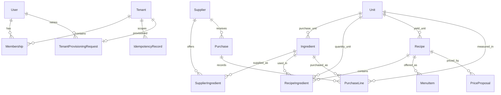

# Ingredia

Ingredia is a multitenant restaurant management SaaS built as a feature first modular monolith with Next.js App Router and TypeScript.

## Local development

Requirements: Node.js 22+, npm, and Docker Compose.

1. Copy `.env.example` to `.env.local` and replace `JWT_SECRET` with a random secret.
2. Start local services with `docker compose up -d`.
3. Run `npm install`, `npm run db:generate`, and `npm run db:migrate`.
4. Start Next.js with `npm run dev`.

`DATABASE_URL` and `DIRECT_URL` should point at the local database for development. `DATABASE_URL` is used by the application and `DIRECT_URL` by Prisma migrations. `TENANT_PROVISIONING_DATABASE_URL` is an optional privileged URL for creating schemas and upgrading tenant schemas; it falls back to `DIRECT_URL`. Keep all three server-side and out of source control. Do not use a `NEXT_PUBLIC_` prefix for secrets. Supabase deployments should use the appropriate pooled URL for runtime and a direct or privileged URL for migrations.

## Commands

- `npm run lint` — ESLint
- `npm test` — Vitest unit tests
- `npm run build` — production build
- `npm run db:generate` — generate Prisma client
- `npm run db:migrate` — apply global Prisma migrations with Prisma Migrate

Tenant SQL migrations are separate from Prisma migrations. `provisionTenant` receives a trusted internal UUID, derives that tenant's schema, and creates its global rows and tenant tables atomically; an owner-scoped idempotency key makes retries safe. `migrateTenantSchema(tenantId)` upgrades only the matching tenant. Both require the privileged provisioning URL. Protected tenant data routes authenticate and verify membership before access. See [database migrations](docs/database.md) for migration operations and data policies.

## Data model and deployment

Global identity and tenant-scoped metadata live in `public`; restaurant business records live in a schema derived from each tenant UUID. All tenant business relations stay within that tenant schema.



Prisma migration `0001_global` already exists, so do not run `npx prisma migrate dev --name init` again. For a new global schema change, create and review a named migration with `npx prisma migrate dev --name <change>` against a development database. Deploy reviewed shared migrations with `npx prisma migrate deploy` (`npm run db:migrate`). `npm run db:generate` only generates the Prisma client.

Tenant schemas have their own ordered SQL files under `prisma/tenant-migrations/` and per-schema checksum history. In a trusted server workflow, provision a tenant using a server-minted UUID and owner-scoped idempotency key; upgrade an existing tenant with `migrateTenantSchema(tenantId)`. The runner validates the UUID, derives the schema server-side, confirms its `public.tenants` mapping, and modifies only that schema. Tenant migrations are not run by Prisma Migrate or automatically during deployment. Use a privileged server-only `TENANT_PROVISIONING_DATABASE_URL`; keep the runtime `DATABASE_URL` pooled and least-privileged. Do not accept tenant IDs as authorization proof or schema names from clients.

Run unit tests with `npm test`. Opt-in PostgreSQL integration tests require an isolated local database ending in `_test`, global migrations already applied, `INGREDIA_TEST_DATABASE_URL`, and `INGREDIA_ALLOW_DB_TESTS=1`; they must never target production. See [database operations and policies](docs/database.md) for details.

## Backend API (v1)

The API uses thin Next.js Route Handlers under `/api/v1`, Zod request schemas, server-only services, Prisma for `public`, and the `pg` pool for tenant schemas. Every protected business request authenticates the JWT cookie and resolves the selected tenant from `x-tenant-id` (or `tenantId` on collection GETs); membership and role are checked against `public` on every request. Schema names are derived from the trusted tenant UUID and checked again by the tenant SQL pool. Never send a schema name from a client.

Implemented endpoints:

| Method | Endpoint | Purpose |
| --- | --- | --- |
| POST | `/api/v1/auth/register` | Create account and set session cookie |
| POST | `/api/v1/auth/login` | Verify credentials and set session cookie |
| POST | `/api/v1/auth/logout` | Same-origin cookie clearing |
| GET | `/api/v1/auth/me` | Safe profile and memberships |
| GET, POST | `/api/v1/tenants` | List memberships / provision a restaurant tenant |
| POST | `/api/v1/tenants/switch` | Verify membership for selected tenant |
| GET, POST | `/api/v1/units` | List / create tenant measurement units |
| GET, PATCH, DELETE | `/api/v1/units/[id]` | Read, rename, or delete an unreferenced unit |
| GET, POST | `/api/v1/ingredients` | Search/page ingredients / idempotent creation |
| GET, PATCH, DELETE | `/api/v1/ingredients/[id]` | Read/update/archive |
| GET, POST | `/api/v1/suppliers` | Search/page suppliers / idempotent creation |
| GET, PATCH, DELETE | `/api/v1/suppliers/[id]` | Read/update/archive |
| GET, POST | `/api/v1/recipes` | Search/page recipes / transactional creation |
| GET, PATCH, PUT, DELETE | `/api/v1/recipes/[id]` | Read/update, replace recipe and ingredient list atomically, archive |

Example authenticated create request:

```http
POST /api/v1/ingredients
Cookie: ingredia_session=<browser-managed>
Origin: http://localhost:3000
x-tenant-id: <membership tenant UUID>
Idempotency-Key: ingredient-create-001
Content-Type: application/json

{"name":"Rice","purchaseUnitId":"<unit UUID from this tenant>"}
```

Write requests require a same-origin `Origin`; use an HTTPS `APP_BASE_URL` in production. Browser code should keep the JWT only in the HttpOnly cookie and send credentials normally; do not read or return the JWT. Access tokens last one hour; logout revokes the token ID in PostgreSQL and clears the cookie. There is no refresh-token flow. Passwords use bcryptjs with work factor 12; inputs are capped at bcrypt's 72 UTF-8 byte limit.

`OWNER` and `ADMIN` can create, update, or archive business records; any authenticated account can create a tenant and becomes its owner. All tenant members can read their tenant data. DELETE endpoints archive records so historical purchases and recipes remain referentially safe. Recipe quantities and units are validated, but cost computation is intentionally not exposed: conversion factors and yield costing are not implemented, so returning a cost would be misleading.

Login/register/tenant creation and create-resource endpoints use PostgreSQL fixed-window counters shared across instances. Apply the new `0003_rate_limits` Prisma migration before serving these routes. The window is 15 minutes / 8 attempts for each normalized login email, one hour / 5 registrations or tenants, and one minute / bounded create operations. API writes for ingredients and suppliers require an `Idempotency-Key`; successful responses are stored with a normalized-payload SHA-256 hash for 24 hours in the same PostgreSQL transaction as creation. Reusing a key with different content returns `409`; in-progress/uncommitted operations roll back and may be safely retried.

For local setup, configure `DATABASE_URL`, `DIRECT_URL`, `TENANT_PROVISIONING_DATABASE_URL`, `JWT_SECRET` (at least 32 random characters), and `APP_BASE_URL`; then run `npm run db:generate` and the reviewed `npm run db:migrate`. The latter is `prisma migrate deploy`; it applies all pending shared migrations, including the rate-limit table. Tenant schemas are created only when `POST /api/v1/tenants` is called and use the SQL migration runner; existing schemas require an explicit trusted `migrateTenantSchema(tenantId)` invocation during an operator-controlled deployment. Do not put database or signing secrets in `NEXT_PUBLIC_*` variables.

The API has unit coverage for request schemas, tenant identifier validation, session token revocation behavior (with mocked persistence), password hashing, and unauthenticated access. PostgreSQL integration tests remain opt-in and are skipped unless pointed at an isolated `_test` database. End-to-end auth/CRUD tests against a live disposable PostgreSQL database, conversion tables, recipe cost calculations, and a dedicated external security review remain outstanding.

## Project map

- `src/app` — App Router pages, layouts, and versioned route handlers
- `src/features` — client safe feature contracts and validation
- `src/server` — server only services, repositories, database, and security
- `prisma` — shared schema and global migrations
- `prisma/tenant-migrations` — ordered tenant schema migrations
- `tests` — unit, integration, end to end, and security tests
- `docs` — architecture and operational decisions

Read [architecture](docs/architecture.md), [database](docs/database.md), and [multitenancy](docs/multitenancy.md) before adding a feature. Security work still required is listed in the docs and implementation plan.
