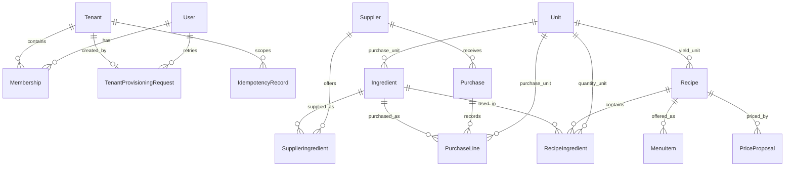

# Database and migrations

Ingredia uses Prisma 6.19.3 for shared relational data in PostgreSQL `public`. Restaurant business data is stored in one generated PostgreSQL schema per tenant and accessed with `pg`; dynamic schemas are not modeled as Prisma schemas.

## Entities and relationships

`User`, `Tenant`, `Membership`, and `IdempotencyRecord` are shared tables. Every entity from `Unit` onward is created inside the tenant schema. No business foreign key crosses tenant schemas.

## Applying global migrations

Set `DATABASE_URL` and `DIRECT_URL`, generate the client with `npm run db:generate`, and apply reviewed migrations with `npm run db:migrate` (`prisma migrate deploy`). Create new shared-schema migrations in development with `prisma migrate dev`; never substitute `prisma db push` for migration history. Do not run migrations automatically as part of build or code generation.

`0001_global` creates the original shared tables. `0002_global_integrity` adds the membership role enum, `users.updated_at`, the generated schema-name check, tenant foreign keys for idempotency records, and lookup/check constraints. The original migration is preserved. The 0002 migration deliberately fails if a pre-existing role is outside `OWNER`, `ADMIN`, `MEMBER` or a stored schema name is not generated-format; reconcile those rows before deploying it.

Deletion policy: deleting a user removes membership rows and their tenant provisioning request records; deleting a tenant removes memberships but is restricted while idempotency or tenant provisioning records refer to it. Business schema deletion is a separate privileged retention operation and is never triggered by deleting a tenant row. Supplier, ingredient, and recipe rows have `archived_at`; menu items can be unpublished or archived. Unit, purchase, and financial history references use `RESTRICT`, preserving historical records. Membership roles are enforced by a PostgreSQL enum.

## Tenant schema lifecycle

`provisionTenant({ tenantId, name, ownerUserId, idempotencyKey })` is a server-only service. `tenantId` must be minted by trusted server code, validated as a UUID, and never accepted directly from an HTTP request. The service derives `tenant_<32 lowercase hex characters>` from that ID; callers cannot choose a schema name. It inserts the global tenant and OWNER membership, creates only that derived schema, applies all ordered SQL files, and records their SHA-256 checksums in `<tenant>._tenant_migrations` in one transaction. A failure rolls the entire new tenant back. The required key is scoped to the owner in `public.tenant_provisioning_requests`; retrying the same normalized request and tenant ID returns the original tenant, while key reuse with a different request fails. A transaction advisory lock serializes concurrent retries. The record is written in the same transaction, so no committed in-progress provisioning record can be stranded.

For an existing tenant, call `migrateTenantSchema(tenantId)`. It validates the internal UUID, loads that exact tenant's row from `public.tenants`, verifies that the stored schema matches the server-derived name, then applies only that tenant's missing versions transactionally. It serializes work per schema with a PostgreSQL advisory lock. An already-applied migration whose checksum changes causes a clear failure. Keep applied migration files immutable and add a new numbered SQL file for each evolution. If a tenant has untracked/manual schema drift, inspect and reconcile it before migration; do not mark it current by hand without verifying its structure. A separate deployment orchestrator can enumerate trusted tenant IDs and call this operation one tenant at a time.

Both services use `TENANT_PROVISIONING_DATABASE_URL`, falling back to `DIRECT_URL`. This connection must be allowed to create schemas and tables; the regular runtime pool should use a least-privilege pooled connection. Keep credentials in server-only environment variables, never in `NEXT_PUBLIC_*` or committed `.env` files. `POST /api/v1/tenants` authenticates the caller, uses an owner-scoped idempotency key, mints a stable internal UUID, then invokes provisioning. The runtime tenant data pool receives only a membership-derived context and verifies the schema against that UUID.

The tenant migrations start with `001_ingredients.sql` and extend it in `002_restaurant_domain.sql`. The latter promotes legacy ingredient unit strings into tenant-local `units`; recognized names get `MASS`, `VOLUME`, or `COUNT`, and unknown non-empty names are retained as `OTHER`. Do not use `OTHER` for automatic conversion or costing until an explicit compatibility rule exists. Repeated ingredients in one recipe remain allowed because preparation states may differ.

## Cost, pricing, and deletion assumptions

Purchases snapshot their currency and each line's actual unit price. `line_total` is a stored generated value rounded to four decimal places from quantity × unit price. Purchase and line history is restricted from deletion; supplier quoted prices remain separate and are never used to rewrite historical purchases. Currency codes are uppercase ISO-style three-letter codes, but the schema does not perform FX conversion. Store quantities and unit prices at four decimal places, menu/proposed sale prices at two; the application must apply the tenant currency's rounding policy consistently.

Cost per recipe batch is the sum of ingredient cost converted to the recipe line's compatible unit, using historical purchase prices under an explicit costing policy. Cost per yield is batch cost divided by positive `yield_quantity`; portion cost requires a yield unit representing the intended serving. The database cannot validate physical unit compatibility or choose FIFO/weighted-average/latest-purchase costing, so those rules belong in the domain service. `target_margin` is a fraction from 0 inclusive to 1 exclusive; for a margin target `m`, the unrounded proposal is `estimated_cost / (1 - m)`, then rounded to the tenant currency's minor unit. A proposal is historical; approving one does not automatically update any menu item. An authorized application action must explicitly update a linked menu item's current sale price.

The initial menu model requires every menu item to reference a recipe. Independent compositions and products without recipes are intentionally outside this migration.

## Validation

Run `npm run db:generate`, `npm run lint`, and `npm test` for local validation. Database integration tests are opt-in and require a disposable local database whose name ends in `_test`, global migrations already applied, and both `INGREDIA_TEST_DATABASE_URL` and `INGREDIA_ALLOW_DB_TESTS=1` (for example, set both variables for the `npm test` command). The suite creates and removes only its generated `tenant_<32 hex>` schemas. It covers provisioning/retry including concurrent retries, schema separation, migration re-application, foreign keys, purchase price history, and idempotency uniqueness. API role and SQL integration coverage still needs a dedicated disposable-database test suite.

Pool sizing must account for all application instances and Supabase limits. The runtime adapter uses one process pool and transaction-local search path; tune its connection limit before scaling.
